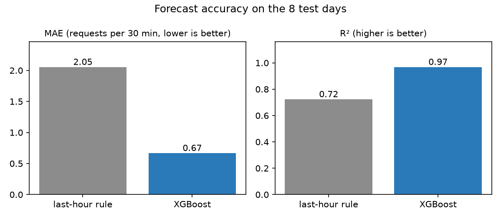
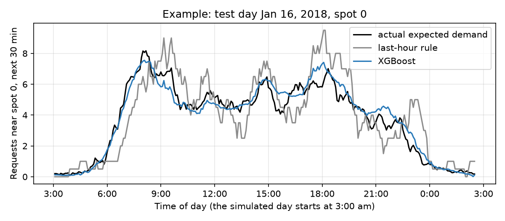
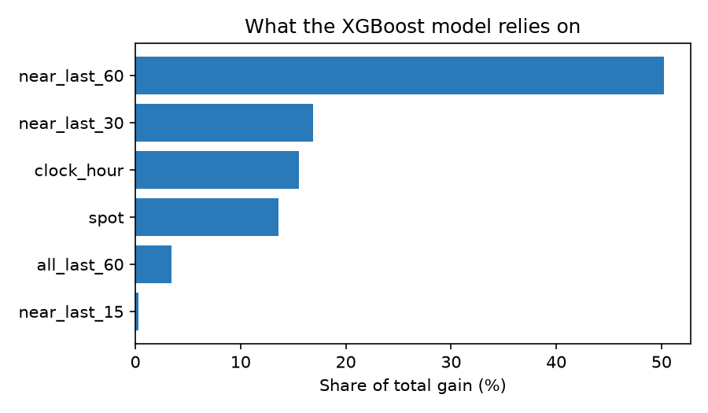
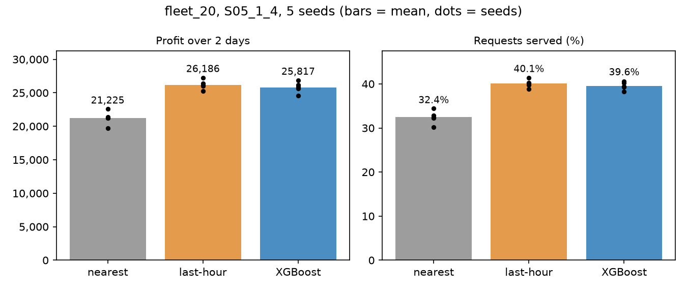
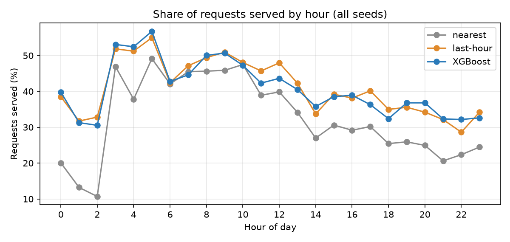

# Where should an idle electric taxi wait? Demand-aware repositioning in OpenHail

This folder holds my small extension of [OpenHail](https://github.com/tommaso-schettini/openhail), an open-source simulator of an electric ride-hailing fleet in Manhattan written by Dr. Tommaso Schettini. The simulator itself is his work and keeps its original MIT license. Everything in this folder (`demand_aware/`) is my addition.

## The question

In a ride-hailing fleet, a car that has just dropped off a customer and has no new job has to wait somewhere. OpenHail's built-in `nearest` policy sends it to the closest waiting spot. That is simple, but the closest spot may be a place where nobody asks for a ride.

So I asked: **does it pay to send idle cars to where the customers are likely to be, instead of to the closest spot?** And if so, does a machine-learning forecast of demand (XGBoost) do better than a simple rule?

## What I compared

All three policies use OpenHail's `nearest` rules for serving customers and for charging. They differ only in where an idle car goes to wait.

| Policy | Where an idle car waits | Written by |
|---|---|---|
| `nearest` | the closest waiting spot | OpenHail (Dr. Schettini) |
| `last_hour` | the reachable spot with the most requests nearby in the last hour | me |
| `xgboost` | the reachable spot with the highest XGBoost forecast of requests nearby in the next 30 minutes | me |

"Nearby" means within the pickup radius: the distance a car can drive before the customer's 400-second pickup deadline, about 1.44 km. "Reachable" means the car has enough battery to get there and then to a charger. If two spots score the same, the nearer one wins.

## The simulation setup

I used OpenHail's own configuration files and changed nothing in the simulator.

| Setting | Value |
|---|---|
| City | Manhattan (61 taxi zones) |
| Fleet (`fleet_20`) | 20 electric cars, about 13 km/h |
| Horizon (`day_2`) | 2 days per run, 2,000 requests per day (4,000 per run) |
| Infrastructure (`S05_1_4`) | 5 waiting spots, 1 charging site with 4 chargers |
| Simulation (`debug_config`) | a decision every time a request appears; a request that no car can reach in time is lost |
| Revenue and cost | 10.75 per trip plus 4.02 per km, minus 0.53 per km driven; charging is free in this setup |
| Runs | 5 seeds (0 to 4), the same for every policy |

### Where the demand comes from

The demand is real. OpenHail ships a random sample of 2018 New York City taxi trip records from the NYC Taxi and Limousine Commission (TLC): 862,219 trips inside Manhattan, each with a pickup zone, a drop-off zone and a time. They cover the 21 weekdays of January 2018 in the file (January 1 and 15, both public holidays, are not included), about 41,000 trips per day.

For each run, OpenHail turns the seed into two real days and draws 2,000 real trips from each day. Each trip keeps its real time, and its pickup and drop-off are placed at a random point inside the real zones. A simulated day starts at 3:00 am. Because the seed fixes all of this, every policy faces exactly the same customers.

| Seed | Real days used (2018) |
|---|---|
| 0 | Jan 16 and Jan 30 |
| 1 | Jan 24 and Jan 19 |
| 2 | Jan 11 and Jan 2 |
| 3 | Jan 30 and Jan 10 |
| 4 | Jan 29 and Jan 2 |

## The XGBoost forecast

**What it predicts:** how many requests will start within reach of each waiting spot in the next 30 minutes.

**What it knows:** only what a car dispatcher would know at that moment:
- the time of day
- which spot
- requests near the spot in the last 15, 30 and 60 minutes
- requests in the whole city in the last 60 minutes

It does not know the day of the week, because the policy is never told which real day it is.

**How I trained it:**
- **Data.** I made training data with OpenHail's own request generator (10 random draws of 2,000 trips for each real day), so the inputs are as noisy as what the policy sees in the simulator. The target is the true expected demand, computed from all real trips of that day.
- **Split by day.** The 8 real days the simulation seeds use are the **test set** and are never used in training. The other 13 days are for training. Splitting by day, not by random rows, avoids leakage, because rows from the same day are almost copies of each other.
- **Choosing the settings.** I chose the tree depth, learning rate and number of trees with 5-fold cross-validation grouped by day, with early stopping. The best setting was depth 5, learning rate 0.05 and 479 trees.

## Results

### 1. Forecast accuracy (8 test days the model never saw)

| Forecast | MAE (requests per 30 min) | R² | Finds the busiest spot |
|---|---|---|---|
| last-hour rule (next 30 min = half of the last hour) | 2.05 | 0.72 | 41% of the time |
| XGBoost | **0.67** | **0.97** | **64%** of the time |





XGBoost forecasts demand about three times more accurately than the last-hour rule. It relies mostly on recent requests near the spot, then on the time of day and on which spot it is.



### 2. Fleet performance (5 seeds, 4,000 requests each)

| Policy | Requests served | Profit over 2 days | vs nearest |
|---|---|---|---|
| nearest | 32.4% | 21,225 | — |
| last_hour | **40.1%** | **26,186** | **+23.4%** |
| xgboost | 39.6% | 25,817 | +21.6% |





## What I learned

1. **Waiting where the customers are pays off.** With the same 20 cars and the same chargers, both demand-aware policies serve about 7 percentage points more customers and earn about 22% more than `nearest`. They win on every seed, and the gain comes entirely from serving more customers, not from longer trips. They do drive more empty, to reach the busy spots, but the extra fares are worth several times that cost.
2. **A better forecast did not mean a better fleet.** XGBoost is far more accurate, yet `xgboost` and `last_hour` end up almost the same. XGBoost earns about 370 less on average, but it wins on 2 of the 5 seeds, and the gap between the two swings from about −1,500 to +900 depending on the seed. With 5 seeds, the two cannot be told apart. My explanation:
   - **The 5 waiting spots are close together** and their 1.44 km circles overlap, so picking the second-best spot instead of the best one loses very little.
   - **Both policies send every idle car to the same top spot.** The real limit is how the cars are spread out, not how precisely the top spot is predicted.
3. **The fleet is still too small.** Even the best policy serves only about 40% of the requests. Repositioning helps, but it cannot replace more cars or better-placed chargers.

The main lesson for me: a forecast is only as useful as the decision that uses it. Measuring forecast error alone would have told the wrong story.

## Next steps I would like to try

- **Spread the cars:** send idle cars to spots in proportion to forecast demand, or cap the number of cars per spot. Then the forecast's numbers matter, not only its top choice.
- **Use more waiting spots and a bigger fleet** (for example `S20_5_20` with `fleet_100`), where choosing the right spot matters more.
- **Run more seeds**, so smaller differences can be measured with confidence.
- **Add the cost of energy and of lost customers,** which this setup leaves out.

## How to run it

1. Install OpenHail as described in its main README (Python 3.10 or newer). From the OpenHail root folder:
   ```
   python -m venv venv
   venv\Scripts\activate          (Windows; on Mac/Linux: source venv/bin/activate)
   pip install -e .
   pip install -r demand_aware/requirements.txt
   ```
2. Train the forecast (about 3 minutes):
   ```
   python demand_aware/train_forecast.py
   ```
3. Run the comparison (about 15 minutes):
   ```
   python demand_aware/run_comparison.py
   ```

Results are written to `demand_aware/results/` and figures to `demand_aware/figures/`. The trained model is in `demand_aware/models/`.

## Files

| File | What it does |
|---|---|
| `settings.py` | seeds, fleet, infrastructure and other shared settings |
| `policies.py` | the `last_hour` and `xgboost` policies, and the feature function shared by training and simulation |
| `train_forecast.py` | builds the training data, cross-validates, trains and tests XGBoost, saves the model and figures |
| `run_comparison.py` | runs the three policies on the same seeds and saves tables and figures |

## What I did myself

- I installed and ran OpenHail.
- I studied how its policies, actions and demand generation work.
- I designed the demand-aware idea and the XGBoost forecast.
- I set up the experiment and the train, validation and test split.
- I checked that the results are reproducible.
- I wrote this analysis.

Parts of the code were written with the help of an AI assistant. I reviewed it, ran it and tested it. All credit for the simulator goes to Dr. Tommaso Schettini and the OpenHail project.

*Started as a personal project in November 2026.*
